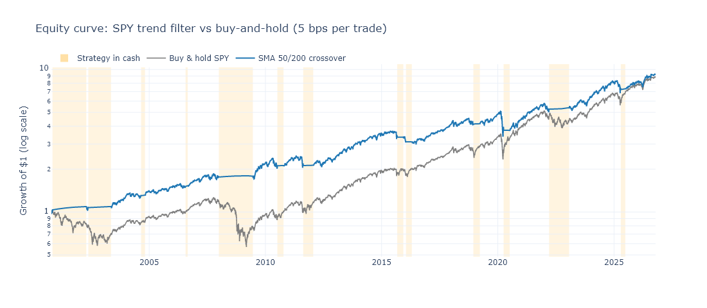
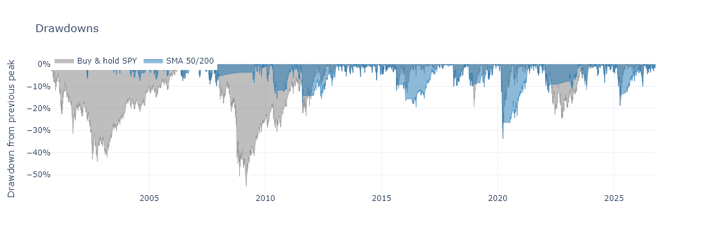
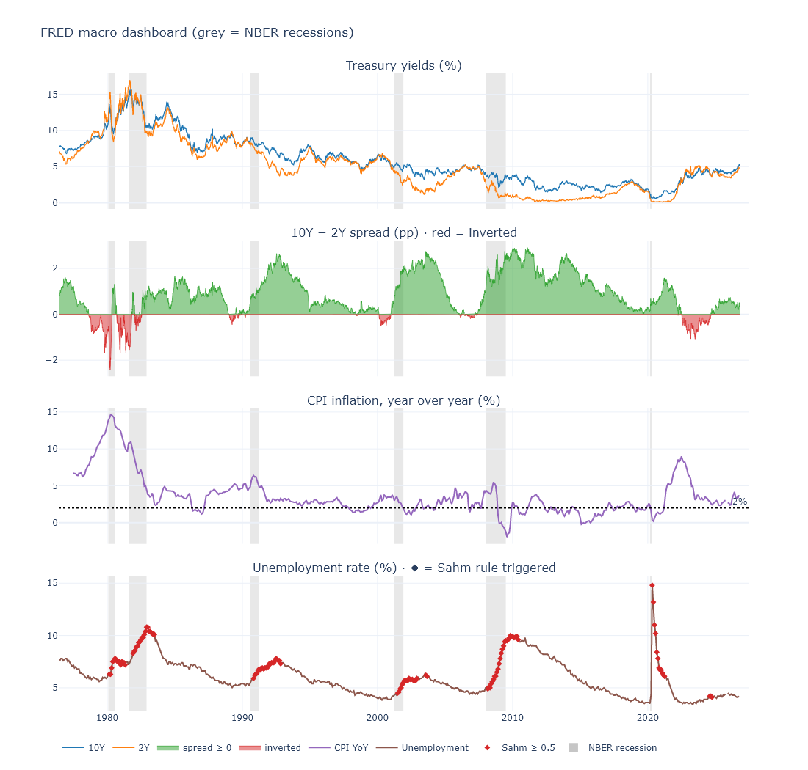
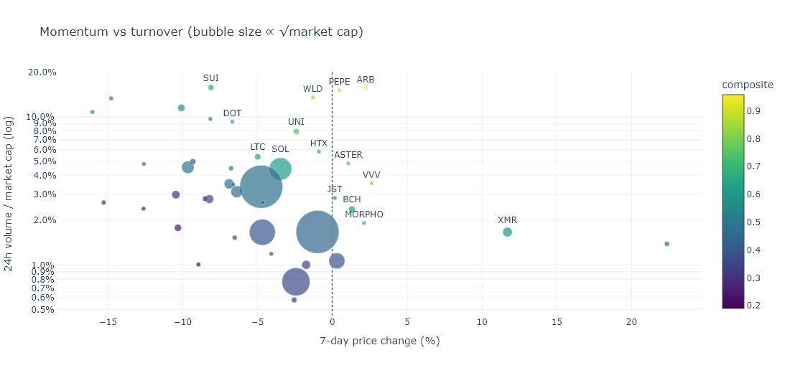
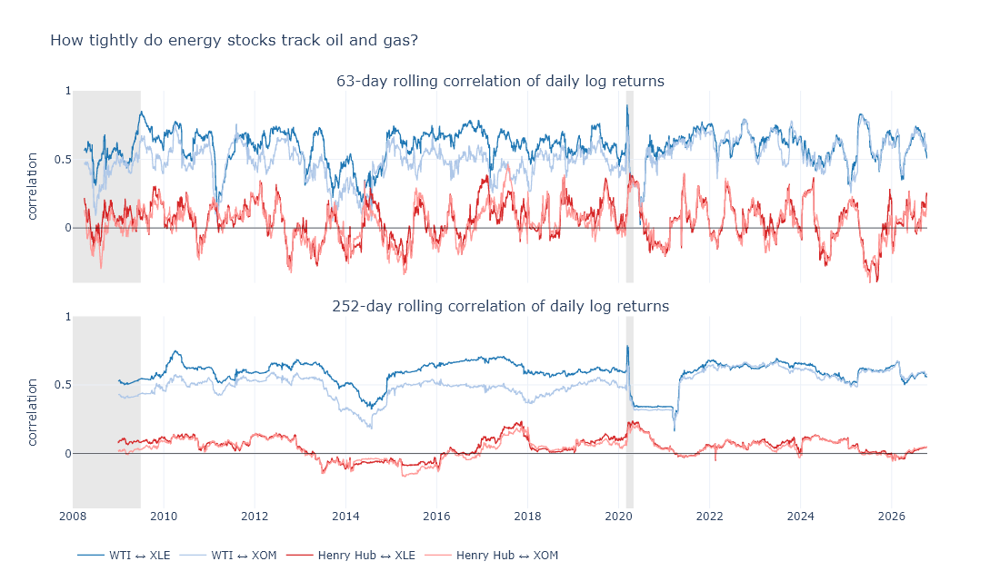
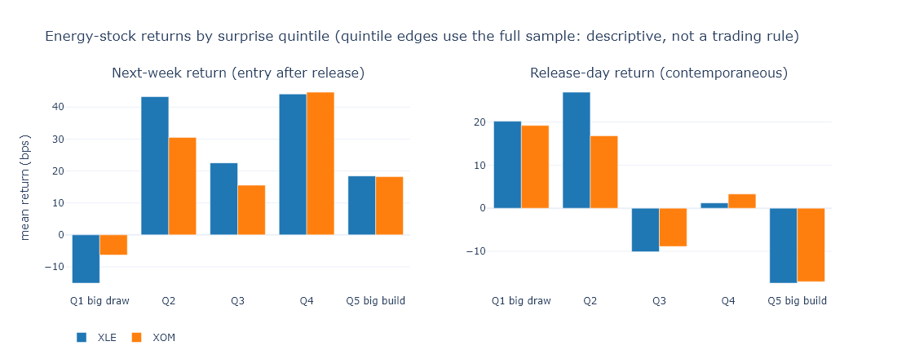
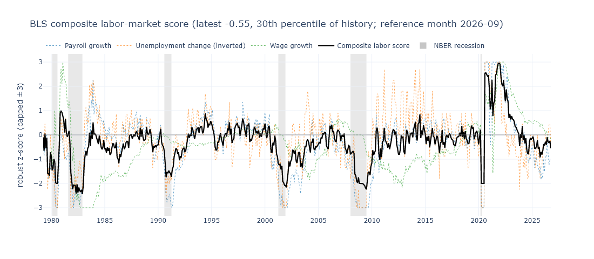
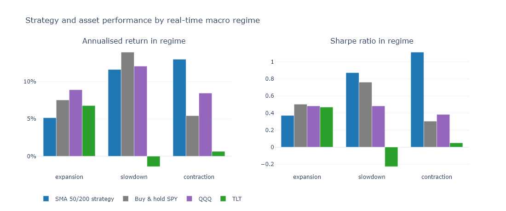
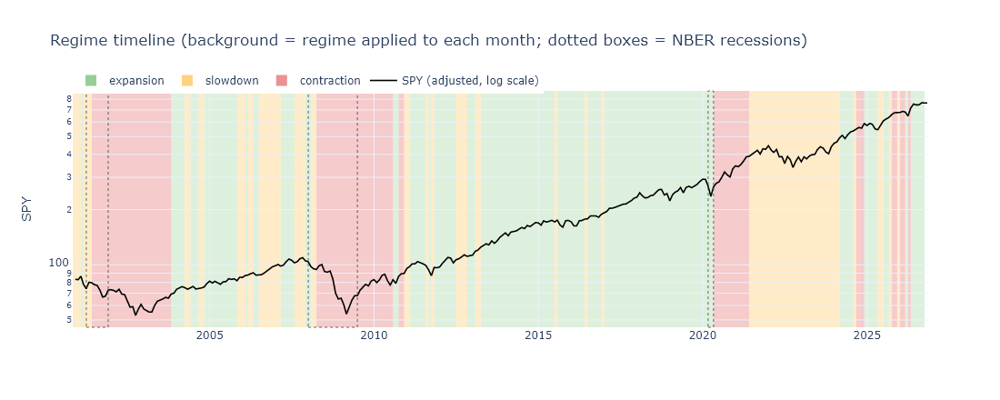

# Macro & Markets Lab

[](https://colab.research.google.com/github/dongos-ai/macro-markets-lab/blob/main/Macro_and_Markets_Lab.ipynb)

A Google Colab research notebook that combines five free data sources (Alpha Vantage/yfinance, FRED, CoinGecko, EIA and BLS) in one macro-to-markets workflow. It backtests a trend-following strategy, builds a macro dashboard and a crypto screener, studies energy stocks against oil, gas and crude inventories, scores the labor market, and labels each month as expansion, slowdown or contraction to see how strategies behave in each regime.

Everything runs with **zero API keys**: every source has a keyless fallback. Look-ahead bias is handled explicitly throughout. Trades fill at the next day's open, macro data are lagged to their real release dates, and z-scores use only past data.



## Modules

| | Question | Data |
|---|---|---|
| **A. Backtester** | Does a 50/200-day moving-average crossover beat buy-and-hold SPY after costs? | Alpha Vantage → yfinance |
| **B. Macro dashboard** | Where are the yield curve, inflation and unemployment relative to past recessions? | FRED |
| **C. Crypto screener** | Which large coins combine strong momentum with heavy turnover? | CoinGecko |
| **D. Energy study** | How closely do XLE/XOM track oil and gas, and do weekly crude-inventory surprises predict next-week returns? | EIA + prices |
| **E. Labor indicator** | One robust z-score for labor-market momentum | BLS |
| **F. Regime study** | How did the strategy, SPY, QQQ and TLT perform in each real-time macro regime? | FRED + BLS + EIA |

## Key results

Reference run on 2026-10-19 with prices through 2026-10-16 and no API keys. The numbers change as data update; the last cell of the notebook prints resume-style bullets computed from your own run.

**A. Trend filter: same return, much smaller drawdowns.** Signal at the close, fill at the next open, 5 bps per trade, October 2000 to October 2026:

| | CAGR | Volatility | Sharpe | Max drawdown | Time in market |
|---|---|---|---|---|---|
| SMA 50/200 crossover | 8.9% | 13.0% | 0.57 | −33.7% | 73% |
| Buy & hold SPY | 8.7% | 19.1% | 0.43 | −55.2% | 100% |

The strategy trades about once a year (13 round trips, 10 of them winners), so it still matches buy-and-hold at 25 bps a trade. It avoided most of 2000–02 and 2008. Its worst drawdown came in the 2020 V-shaped crash, which it exited after the bottom.



**B. The yield curve warned early, with long and variable lags.** Five of the six recessions since 1980 followed a sustained 10Y–2Y inversion, with a median lead of 17 months (range 11–23). The exception was 2020, a pandemic shock preceded only by a few days of inversion. The 2022–24 inversion (26 months) is the longest on record and has not yet been followed by a recession.



**C. Crypto screen.** After excluding stablecoins, tokenized funds and gold, and illiquid coins, 44 of the top 100 remain. Coins are ranked on 24h/7d momentum and volume-to-market-cap. This is a live snapshot screen, not a backtested signal.



**D. Energy stocks track oil, not gas, and inventory news is priced fast.** Since 2008, XLE's daily correlation with WTI is about 0.5 (0.59 weekly), against 0.04 with Henry Hub gas. Crude-inventory surprises move XLE on the release day (t = −3.2) but do not predict next-week returns (t = 1.2, p = 0.22).




**E. The labor score separates recessions.** The composite averages −1.72 in NBER recession months vs −0.12 in other months. The latest reading, for September 2026, is −0.55 (30th percentile).



**F. Real-time regimes lag the cycle, and that matters.** The rules label 86% of NBER recession months as contraction, but only 34% of contraction months were recessions, because labor data keep deteriorating through jobless recoveries. In contraction months the trend strategy's Sharpe ratio was **1.11 vs 0.30** for buy-and-hold SPY (90% bootstrap interval for the gap: +0.21 to +1.44). TLT hedged actual recessions (+9.3% annualized) but not real-time contraction months (+0.6%).




## Avoiding look-ahead bias

- **Trading:** signals use day *t*'s close and execute at day *t+1*'s open. The overnight gap belongs to the old position and costs are charged on traded notional.
- **Macro data:** CPI and jobs data are re-stamped to the month they were actually published, including the shutdown-delayed Sep–Nov 2025 jobs reports. The regime known at the end of month *t* is matched to returns in month *t+1*.
- **Inventories:** each weekly EIA report gets its real release date (Wednesday, or Thursday after a federal holiday). Forward returns start after that date.
- **Statistics:** z-scores use expanding windows (past data only). NBER recession dates are used only for shading and evaluation.

## Running it

**Google Colab (recommended).** Click the **Open in Colab** badge at the top, then choose *Runtime → Run all*. To use primary sources and higher limits, add any of these optional keys in Colab's 🔑 **Secrets** panel and turn on *Notebook access*:

| Secret | Free key | Without it |
|---|---|---|
| `ALPHAVANTAGE_API_KEY` | [alphavantage.co](https://www.alphavantage.co/support/#api-key) | yfinance. The free AV tier only serves 100 days of history, so the fallback is expected. |
| `FRED_API_KEY` | [fredaccount.stlouisfed.org](https://fredaccount.stlouisfed.org/apikeys) | keyless `fredgraph.csv` |
| `EIA_API_KEY` | [eia.gov/opendata](https://www.eia.gov/opendata/register.php) | FRED mirrors + EIA history file |
| `BLS_API_KEY` | [data.bls.gov](https://data.bls.gov/registrationEngine/) | keyless BLS v1, then FRED mirrors |
| `COINGECKO_API_KEY` | [coingecko.com](https://www.coingecko.com/en/api/pricing) (Demo plan) | keyless public API |

**Locally:**

```bash
pip install -r requirements.txt
```

```bash
jupyter lab Macro_and_Markets_Lab.ipynb
```

Outside Colab, keys are read from environment variables with the same names. Every API response is cached to disk in `macro_lab_cache/`, so reruns don't use up free-tier limits. Requests are retried with exponential backoff, and failed responses are never cached.

## How it was checked

- The notebook ran end to end with 0 errors on pandas 2.3 / plotly 5.24 (close to Colab's versions) and on pandas 3.0 / plotly 7.1, with identical numbers.
- **Look-ahead:** perturbation tests changed every input after a date *T* and confirmed that no output dated on or before *T* moved, for the backtest, the labor score, the regime labels and the inventory study.
- **Backtest:** an independent re-implementation matches it to about 1e-16.
- **API paths:** the keyed paths were tested against mocked responses built from live probes, covering rate-limit and premium messages, pagination, empty payloads and bad keys.
- **Outages:** failure injection turned off each of 20 data sources in turn. *Run all* still finishes every time and skips only the modules that need the missing data.

## Limitations

- FRED and BLS serve revised data, not the vintages that were available in real time. Jobs data in particular are revised for months.
- The backtest uses a flat cost and next-open fills, with no taxes or slippage model. 50/200 is the textbook setting, but it is famous partly *because* it worked.
- Yahoo prices come through yfinance, an unofficial API, and are for personal research use.
- The inventory surprise is measured against a five-year seasonal norm, not the analyst consensus. Quintile cut-offs are in-sample.
- There are only a few contraction episodes, so per-regime statistics are noisy.
- The crypto screen is a single snapshot of today's top 100, which carries survivorship bias.

## Repository contents

```
Macro_and_Markets_Lab.ipynb   the notebook (32 labeled cells)
images/                       charts from the reference run
requirements.txt              packages for running outside Colab
```

## License

[MIT](LICENSE). This is research code, not investment advice. Data belong to their providers and are subject to their terms.
